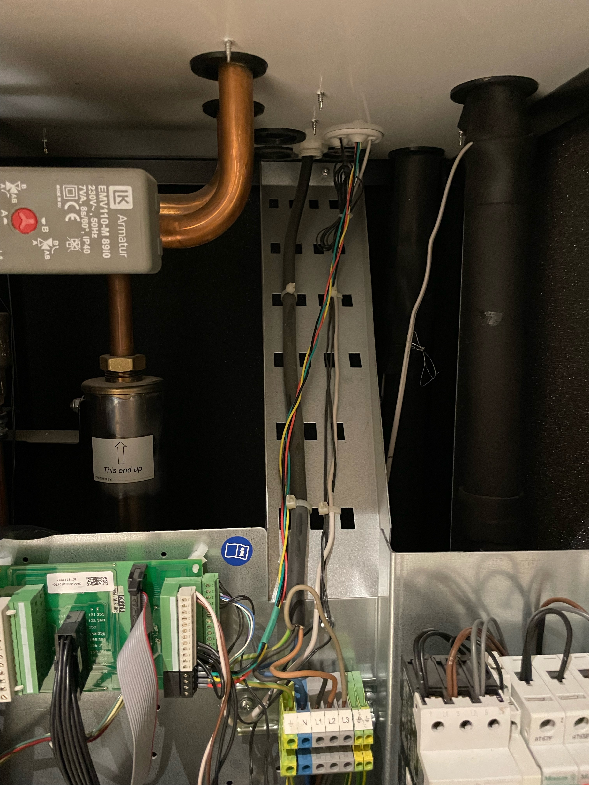
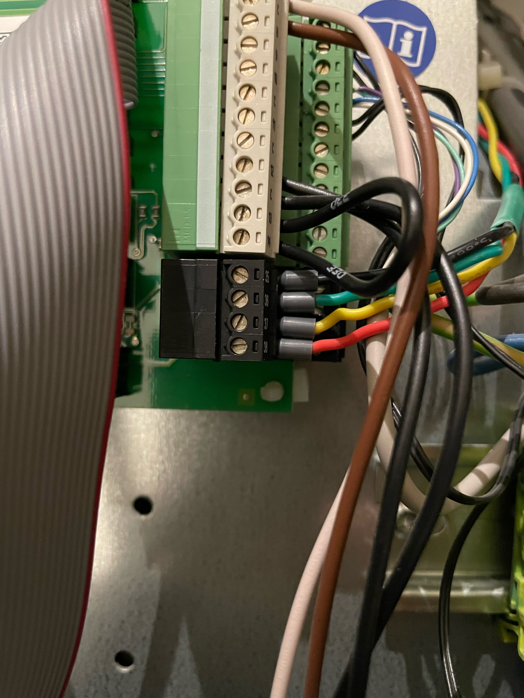

ESPHome component for Rego 1000 heat pump controller, found in:
* IVT Greenline HE/HC/HA
* IVT Premiumline A Plus
* IVT Premiumline EQ
* IVT Premiumline HQ

### Features
* Poll any variable from heat pump (temperature sensors, timers, PID control values..)
* Read any passive data on the heat pump CAN bus (used for i.e. compressor on/off state)
* Set indoor setpoint using the Home assistant climate integration
* Act as an IVT indoor sensor using the tempeature from a home assistant integrated temperature sensor
* Set any heat pump variable, e.g. hysterisis, admin access, hot water eco/comfort mode

### Installation
Make changes to secrets and CAN bus pins in rego1000.yaml, then install it on the ESP32 using
```bash
esphome run rego1000-<version>.yaml
```

### Connection



<table>
  <tr>
    <th>Colour</th>
    <th>Function</th>
    <th>Pint No.</th>
  </tr>
  <tr>
    <td>Black</td>
    <td>Ground</td>
    <td>35</td>
  </tr>
  <tr>
    <td>Green</td>
    <td>can L</td>
    <td>36</td>
  </tr>
  <tr>
    <td>Yellow</td>
    <td>can H</td>
    <td>37</td>
  </tr>
  <tr>
    <td>Red</td>
    <td>+12v</td>
    <td>38</td>
  </tr>
</table>

### Heating curve
The heating curve of the heat pump's own circuit can be read and adjusted from Home Assistant,
see [heating-curve.yaml](heating-curve.yaml) (include it as a package) and the dashboard card
[heating-curve-card.yaml](heating-curve-card.yaml) (needs plotly-graph-card).

How the Rego 1000 stores the curve (verified on v3.6 against the display and `HEATING_CURVE_VALUE`):
* The curve has 11 points (`HEATING_CURVE_NO_OF_POINTS`), every 5 °C from the dimensioning outdoor
  temperature (`HEATING_CURVE_RIGHT_X_LOCAL`, e.g. -30 °C) up to +20 °C.
* A straight base line runs from `HEATING_CURVE_LEFT_Y_LOCAL` at +20 °C to `HEATING_CURVE_RIGHT_Y_LOCAL`
  at the dimensioning temperature.
* Each point is the base line **plus an offset** `HEATING_CURVE_Y1_LOCAL` ... `HEATING_CURVE_Y11_LOCAL`
  (Y1 = coldest point, Y11 = +20 °C). The fine-tuned points on the display are these offsets.
* The pump interpolates linearly between the points using the attenuated outdoor temperature
  (`GT2_ATTENUATED_TEMP`). `HEATING_SETPOINT` is the curve value plus the room sensor influence.
* **Use the `*_LOCAL` variables.** The `*_GLOBAL` variants (and `HEATING_CURVE_Y*_GLOBAL`) belong to
  extra mixing circuits; writing them does not change the pump's own curve. Writing `*_LOCAL` works
  without admin access.

The example exposes one number per outdoor temperature that shows and sets the actual supply
temperature; the offset is calculated in ESPHome.

To tune the curve, watch `Room sensor contribution` (setpoint minus curve value) over a few days.
If it is consistently positive at a given outdoor temperature the curve is too low there, if
consistently negative too high. Adjust the nearest points by about half the daily average and
wait a couple of days between changes.

### Additional heat (electric heater)
`additional-heat.yaml` is a package that shows and limits the electric heater from Home Assistant:
```yaml
packages:
  additional_heat: !include additional-heat.yaml
```
What we found on an IVT Greenline HE E9 (Rego 1000 v3.6, 3 + 6 kW heater = 3 / 6 / 9 kW steps), checked against
a P1 electricity meter:
* The `0x3C` additional heat broadcast is the reliable on/off signal: consumption rose by exactly the allowed
  step (3 kW, ~1 kW per phase) while it was on. `TILLSKOTT_UTSIGNAL_UT` stayed at 0 % the whole time, and
  `HW_ADDITIONAL_RELAY_x`/`TRIAC_x` always read 0.
* `ADDITIONAL_EFFECT_LIMITATION_COMPRESSOR` (0.1 kW) caps the heater while the compressor runs. Ours was 9.0 kW;
  3.0 kW limits it to the first step. `ADDITIONAL_TOTAL_EFFECT_PATRON` is the installed power.
* `ADDITIONAL_BLOCKED` = 1 does not necessarily mean the menu setting `ADDITIONAL_USER_BLOCKED`. On our unit the
  cause was `ADDITIONAL_BLOCK_HIGH_T2_TEMP` (max outdoor temperature for additional heat, 0.1 °C) set to -0.5 °C,
  shown by `ADDITIONAL_BLOCK_HIGH_T2` = 1. After raising it the heater started once `ADDITIONAL_DELAY_TIME`
  (minutes) had passed.
* `STATS_ELECTR_ADD_HEATING` / `STATS_ELECTR_ADD_DHW` count seconds.
* All settings in the package could be written without admin access.

Heater sizes and steps differ between models, so check `Additional heat max power` before choosing a limit.

### Hot water circulation, extra hot water and clock
The example config also shows how to control things that are normally set on the display:
* **DHW circulation**: `PUMP_DHW_ACTIVE` enables the circulation pump, `PUMP_DHW_PROGRAM1..4_START/STOP_TIME`
  are its daily programs. Times are stored in 15 minute slots (`0x30` = 12:00, `0x35` = 13:15) and `0xD0` means
  the program is off. The pump output itself is broadcast on `0x00044${REGO_CAN_SUFFIX}`.
* **Extra hot water / thermal disinfection**: `XDHW_TIME` starts extra hot water for N hours,
  `XDHW_WEEKPROGRAM_DAY` (0 = off, 1 = Monday ... 7 = Sunday) and `XDHW_WEEKPROGRAM_HOUR` schedule the weekly run
  (stop temperature in `XDHW_WEEKPROGRAM_STOP_TEMP`, 0.1 °C). `ADDITIONAL_ALLOW_XDHW` must be on for the
  electric heater to help reach 60-65 °C; with it off our tank never got above ~47 °C.
* **Clock**: `DATE_YEAR/MONTH/DAY/DAY_OF_WEEK/HOUR/MIN` are writable. The controller clock can drift a lot
  (ours was 9.5 h behind), which shifts every timed program, so syncing it daily from Home Assistant is worth it.

Other output broadcasts seen on our unit (`0x000XX${REGO_CAN_SUFFIX}`, one byte, every ~20 s):
`0x28` heat carrier pump, `0x2C` heat fluid pump, `0x38` three-way valve, `0x3C` additional heat,
`0x44` DHW circulation pump, `0x48` compressor, `0x54` cold fluid pump; `0x30`, `0x34`, `0x40`, `0x4C` unknown.

### Finding unknown variables
Settings changed on the display are not sent over this CAN bus, but the controller answers polls for every
variable, so you can find a setting by reading all variables before and after changing it on the display.
Add this to your config, enable `CAN sniffer`, press `Scan variables`, record `esphome logs`, change the setting,
repeat and diff the replies (reply id `0x0C003FE0 | var << 14`). Set the last index to the highest variable
in your `rego1000-<version>.yaml`.

```yaml
canbus:
  - platform: esp32_can
    # ... id: can0 etc.
    on_frame:
      - can_id: 0
        can_id_mask: 0
        use_extended_id: true
        then:
          - lambda: |-
              if (id(can_sniff).state)
                ESP_LOGI("cansniff", "%08X rtr=%d %s", (unsigned) can_id,
                         (int) remote_transmission_request, format_hex_pretty(x).c_str());
globals:
  - id: scan_idx
    type: int
    initial_value: '-1'
interval:
  - interval: 60ms
    then:
      - lambda: |-
          if (id(scan_idx) < 0) return;
          if (id(scan_idx) > 0x0AC5) { ESP_LOGI("cansniff", "SCAN DONE"); id(scan_idx) = -1; return; }
          id(can0)->send_data(((uint32_t) id(scan_idx) << 14) | 0x04003FE0, true, true, std::vector<uint8_t>());
          id(scan_idx)++;
switch:
  - platform: template
    name: CAN sniffer
    id: can_sniff
    optimistic: true
    restore_mode: ALWAYS_OFF
button:
  - platform: template
    name: Scan variables
    on_press:
      - lambda: 'ESP_LOGI("cansniff", "SCAN START"); id(scan_idx) = 0;'
```
