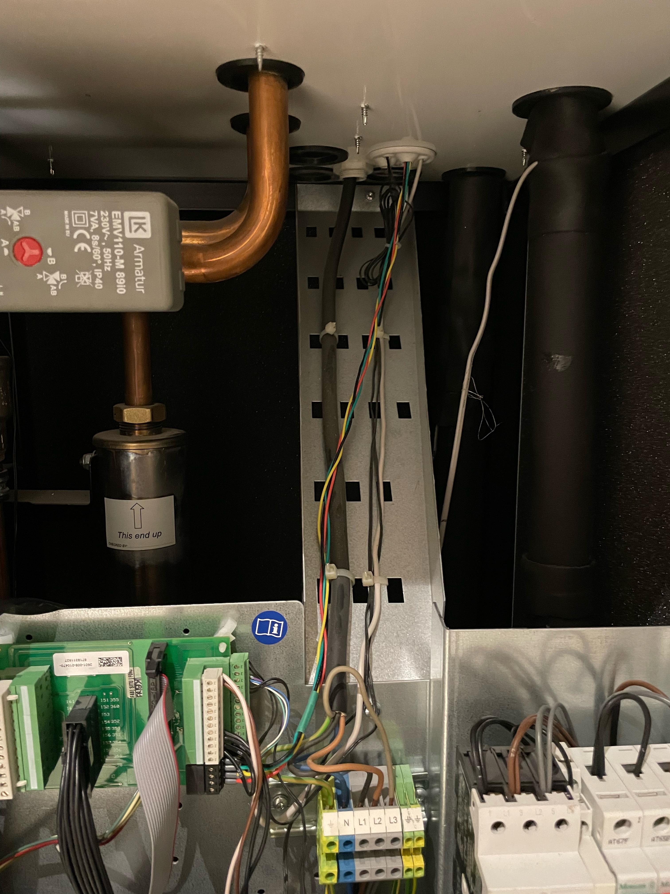
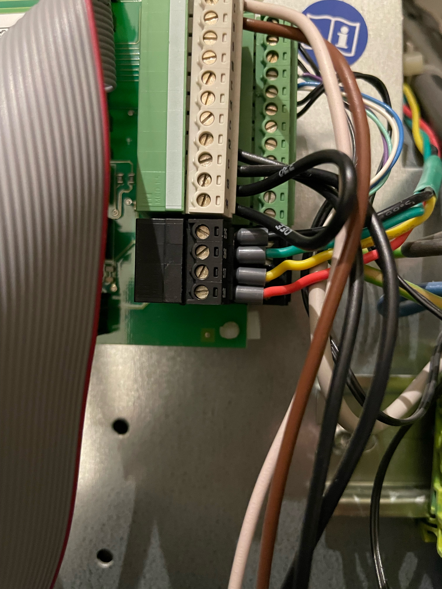

ESPHome component for Rego 1000 heat pump controller, found in:
* IVT Greenline HE/HC/HA
* IVT Premiumline A Plus
* IVT Premiumline EQ
* IVT Premiumline HQ

### Features
* Poll any variable from heat pump (temperature sensors, timers, PID control values..)
* Read any passive data on the heat pump CAN bus (used for i.e. compressor on/off state)
* Set indoor setpoint using the Home assistant climate integration
* Act as an IVT indoor sensor using the tempeature from a home assistant integrated temperature sensor
* Set any heat pump variable, e.g. hysterisis, admin access, hot water eco/comfort mode

### Installation
Make changes to secrets and CAN bus pins in rego1000.yaml, then install it on the ESP32 using
```bash
esphome run rego1000-<version>.yaml
```

### Connection



<table>
  <tr>
    <th>Colour</th>
    <th>Function</th>
    <th>Pint No.</th>
  </tr>
  <tr>
    <td>Black</td>
    <td>Ground</td>
    <td>35</td>
  </tr>
  <tr>
    <td>Green</td>
    <td>can L</td>
    <td>36</td>
  </tr>
  <tr>
    <td>Yellow</td>
    <td>can H</td>
    <td>37</td>
  </tr>
  <tr>
    <td>Red</td>
    <td>+12v</td>
    <td>38</td>
  </tr>
</table>

### Hot water circulation, extra hot water and clock
The example config also shows how to control things that are normally set on the display:
* **DHW circulation**: `PUMP_DHW_ACTIVE` enables the circulation pump, `PUMP_DHW_PROGRAM1..4_START/STOP_TIME`
  are its daily programs. Times are stored in 15 minute slots (`0x30` = 12:00, `0x35` = 13:15) and `0xD0` means
  the program is off. The pump output itself is broadcast on `0x00044${REGO_CAN_SUFFIX}`.
* **Extra hot water / thermal disinfection**: `XDHW_TIME` starts extra hot water for N hours,
  `XDHW_WEEKPROGRAM_DAY` (0 = off, 1 = Monday ... 7 = Sunday) and `XDHW_WEEKPROGRAM_HOUR` schedule the weekly run
  (stop temperature in `XDHW_WEEKPROGRAM_STOP_TEMP`, 0.1 °C). `ADDITIONAL_ALLOW_XDHW` must be on for the
  electric heater to help reach 60-65 °C; with it off our tank never got above ~47 °C.
* **Clock**: `DATE_YEAR/MONTH/DAY/DAY_OF_WEEK/HOUR/MIN` are writable. The controller clock can drift a lot
  (ours was 9.5 h behind), which shifts every timed program, so syncing it daily from Home Assistant is worth it.

Other output broadcasts seen on our unit (`0x000XX${REGO_CAN_SUFFIX}`, one byte, every ~20 s):
`0x28` heat carrier pump, `0x2C` heat fluid pump, `0x38` three-way valve, `0x3C` additional heat,
`0x44` DHW circulation pump, `0x48` compressor, `0x54` cold fluid pump; `0x30`, `0x34`, `0x40`, `0x4C` unknown.

### Finding unknown variables
Settings changed on the display are not sent over this CAN bus, but the controller answers polls for every
variable, so you can find a setting by reading all variables before and after changing it on the display.
Add this to your config, enable `CAN sniffer`, press `Scan variables`, record `esphome logs`, change the setting,
repeat and diff the replies (reply id `0x0C003FE0 | var << 14`). Set the last index to the highest variable
in your `rego1000-<version>.yaml`.

```yaml
canbus:
  - platform: esp32_can
    # ... id: can0 etc.
    on_frame:
      - can_id: 0
        can_id_mask: 0
        use_extended_id: true
        then:
          - lambda: |-
              if (id(can_sniff).state)
                ESP_LOGI("cansniff", "%08X rtr=%d %s", (unsigned) can_id,
                         (int) remote_transmission_request, format_hex_pretty(x).c_str());
globals:
  - id: scan_idx
    type: int
    initial_value: '-1'
interval:
  - interval: 60ms
    then:
      - lambda: |-
          if (id(scan_idx) < 0) return;
          if (id(scan_idx) > 0x0AC5) { ESP_LOGI("cansniff", "SCAN DONE"); id(scan_idx) = -1; return; }
          id(can0)->send_data(((uint32_t) id(scan_idx) << 14) | 0x04003FE0, true, true, std::vector<uint8_t>());
          id(scan_idx)++;
switch:
  - platform: template
    name: CAN sniffer
    id: can_sniff
    optimistic: true
    restore_mode: ALWAYS_OFF
button:
  - platform: template
    name: Scan variables
    on_press:
      - lambda: 'ESP_LOGI("cansniff", "SCAN START"); id(scan_idx) = 0;'
```
